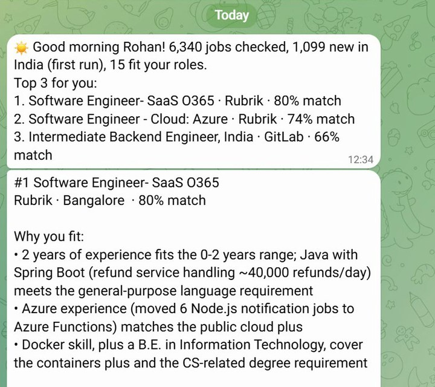
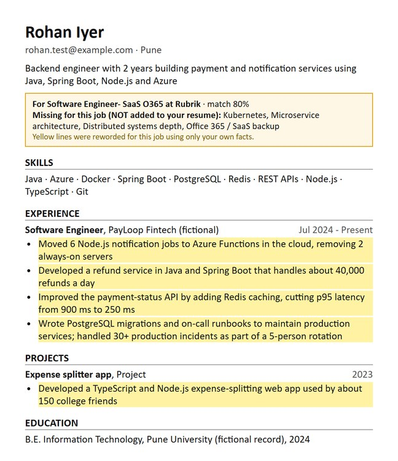
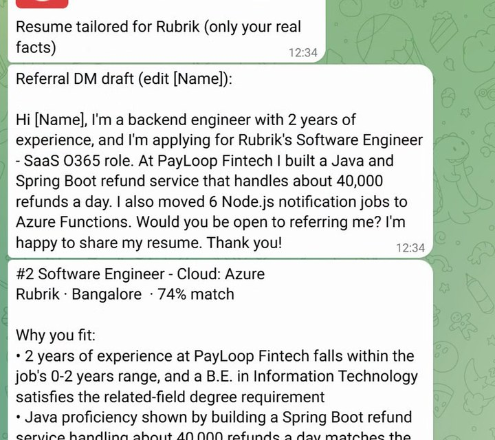

# Lazy Job Hunter

**Har subah 8 baje se pehle, Telegram pe aapki top 3 nayi jobs. Resume har job ke liye tailor, sirf aapke real facts se.**

Every morning before 8 AM your Telegram gets:

- the **top 3 new jobs in India** that fit your resume, with a match score and the reasons
- what you're **missing** for each job (flagged, never added to your resume)
- a **resume PDF tailored to each job**, using only facts already in your resume
- a **referral message draft** for someone at that company

It never applies for you. You read 3 jobs, you apply yourself.

## 📱 Came here from Instagram?

Setup needs a **laptop** (Windows is easiest; Mac works too) and takes about **20 minutes, once**. After that it runs by itself every morning.

**Save this link and open it on your laptop:** `github.com/Akshatb848/lazy-job-hunter`

1. **[Download the ZIP](https://github.com/Akshatb848/lazy-job-hunter/archive/refs/heads/main.zip)** and unzip it.
2. Follow **[SETUP.md](SETUP.md)**, step by step.
3. Your first top 3 lands in Telegram. 🎉

**Cost:** free with a free NVIDIA AI key and a free Telegram bot. A Claude key is optional, for better tailoring.

---

## What you get every morning
*From a real run on a fictional test resume.*

**1. Your top 3 jobs in Telegram, with why you fit**

**2. A resume tailored to each job** (yellow = reworded from your own lines, amber box = what's missing, never added)

**3. A referral message ready to send**

---

## Why you can trust the resumes
- A guard checks every line the AI writes. Any skill, tool or number that isn't in your resume is blocked and the original line is kept.
- Tested on fictional resumes: **18 tailored resumes, 0 invented skills or numbers**. 19 automatic guard tests run with `python test_guard.py`.
- Everything runs on **your own laptop**. Your resume and keys never leave it, except the text sent to the AI to score and tailor.

## Honest limits
- Jobs come from **34 public company career boards** (Greenhouse, Lever, Ashby): Rubrik, GitLab, Stripe, Databricks, Paytm, CRED, Groww and more. It does **not** scrape LinkedIn or Naukri.
- Fresher roles are thinner on these boards. On a weak day it says "no strong matches" instead of padding the list.
- Scores are a guide, not a promise. No interviews are promised.

## Worked for you? 🙌
- **DM "DONE" to [@the_lazy_automator](https://www.instagram.com/the_lazy_automator/) on Instagram**, with a screenshot of your first Telegram message.
- Tap **⭐ Star** at the top of this page.
- Send it to a friend who scrolls job portals every night.

**Stuck?** Open an [issue](https://github.com/Akshatb848/lazy-job-hunter/issues/new) with the error message (never paste your keys), or DM on Instagram.

Made by [@the_lazy_automator](https://www.instagram.com/the_lazy_automator/).
